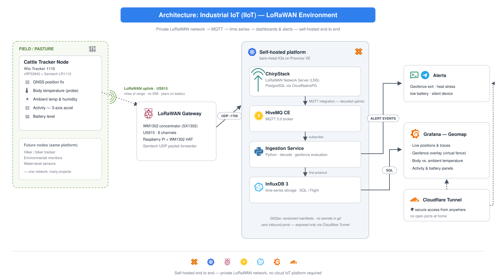

# Platform Architecture



## End-to-end data flow

```
Device (LR1110)  ──LoRaWAN US915──>  WM1302 gateway (Raspberry Pi)
                                            │  Semtech UDP :1700
                                            ▼
                                     ChirpStack (K3s)
                                            │  MQTT integration — decoded uplinks
                                            ▼
                              HiveMQ CE  →  Ingestion service  →  InfluxDB 3
                                                  │                    │
                                                  │ geofence events    │ SQL / Flight
                                                  ▼                    ▼
                                          Alerts (ntfy/Telegram)   Grafana geomap
```

## Components

### Devices

Battery-powered LoRaWAN Class A nodes. The flagship device is the **Seeed Wio Tracker 1110** (Nordic nRF52840 MCU + Semtech **LR1110** radio). The LR1110 matters: beyond LoRa, it scans **GNSS (GPS/BeiDou)** and **WiFi MAC addresses** for positioning — the same silicon used in commercial asset trackers. Indoors, where GNSS fails, WiFi scanning still yields a position; outdoors, GNSS scans cost a fraction of the energy of a traditional always-on GPS receiver because position *solving* is offloaded to the network side.

### Gateway

A **Seeed WM1302** concentrator module (Semtech SX1302 baseband, SPI variant, US915) on the official Raspberry Pi HAT. The SX1302 demodulates 8 channels concurrently — this is what makes it a real multi-device gateway rather than a single-channel test rig. The Pi runs the Semtech UDP packet forwarder pointed at ChirpStack. Build notes, OS provisioning, and configuration live in [`platform/gateway/`](../platform/gateway/).

### Network server — ChirpStack

[ChirpStack](https://www.chirpstack.io/) is the LoRaWAN Network Server (LNS): it handles device joins (OTAA), deduplicates uplinks received by multiple gateways, manages the MAC layer (data rates, channel plans, ADR), and decodes application payloads via per-device codecs.

It runs on a bare-metal **K3s** cluster:

- **PostgreSQL** provisioned by the CloudNativePG operator (the cluster's standard pattern for stateful services)
- **Redis** for device sessions and dedup state
- Version-controlled manifests in [`platform/chirpstack/`](../platform/chirpstack/)

An earlier iteration of this deployment ran on Docker Compose on a standalone host. The move to K3s follows the same prototype → production path as the rest of the platform, and its migration notes are kept as an architecture decision record.

### Messaging — HiveMQ CE

ChirpStack's MQTT integration publishes every decoded uplink as JSON to a **HiveMQ Community Edition** broker (MQTT 5.0). The broker is the decoupling point of the platform: any number of consumers (ingestion, debugging clients, future services) subscribe without touching the LNS.

### Ingestion service

A small Python service subscribes to the uplink topics and:

1. Validates and flattens the decoded payload
2. Evaluates **geofences** (point-in-polygon against stored fence polygons) and emits exit/entry events
3. Writes measurements to InfluxDB 3 (line protocol), idempotent per device EUI + frame counter
4. Publishes alert events (geofence exit, heat stress, low battery, silent device) to the notification stack

Malformed payloads are logged and dropped — they never crash the consumer.

### Storage — InfluxDB 3

Time-series store for all telemetry (`location`, `telemetry`, `device_health` measurements, tagged by device EUI / animal ID). Queried over SQL (Flight).

### Dashboards & alerts

- **Grafana geomap**: live positions, movement traces, geofence overlays, temperature and activity panels.
- **Alerts** ride an existing self-hosted notification stack (ntfy + Telegram).

### Access — Cloudflare Tunnel

Nothing on this platform is reachable from the internet directly. Dashboards are exposed through **Cloudflare Tunnel** (outbound-only connector): zero inbound ports, zero port forwarding.

## Security posture

- **Radio:** LoRaWAN OTAA join with per-device root keys; AES-128 at both network and application layers (standard LoRaWAN 1.0.x security model).
- **Secrets:** no keys or EUIs in git — examples use placeholders; a gitleaks scan gates every push.
- **Network:** private plane by default; only dashboards exit via the tunnel.
- **Telemetry vs control:** this platform is deliberately a read-only telemetry plane. Downlink/control (device reconfiguration over the air) is a separate concern with its own auth and audit requirements, out of scope for now.

## Design principles

1. **Documentation-first.** Every phase leaves the repo complete at its level — designs are written before hardware is wired.
2. **Reuse the proven shape.** MQTT → ingestion → time series → dashboards is a pattern already operating in production elsewhere; this platform applies it to LoRaWAN.
3. **Honest status.** [The roadmap](roadmap.md) states what runs today versus what is designed but not yet built.
