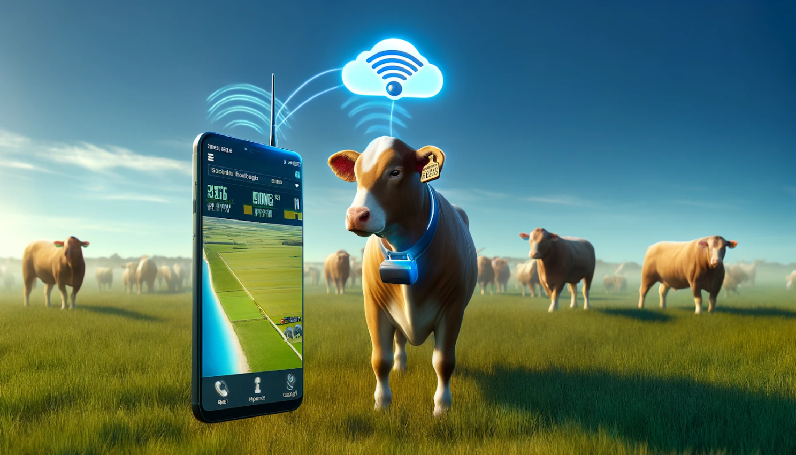
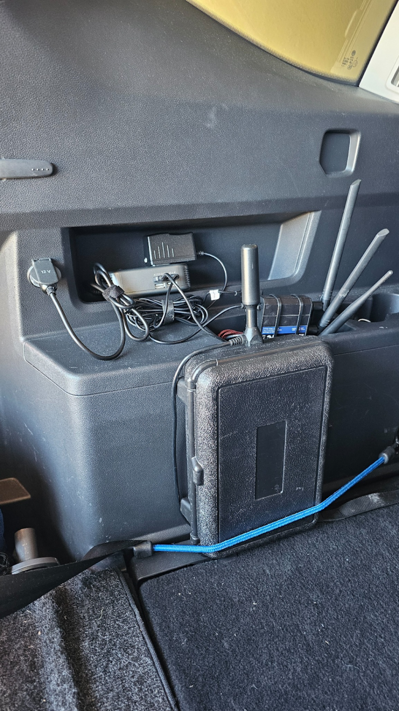

# Cattle Tracker

A GPS collar prototype for livestock: **location, body temperature, ambient conditions, and activity**, reported over a private LoRaWAN network — with server-side geofencing that turns position data into **virtual-fence alerts**.

## The problem

A rancher running rotational grazing moves animals between paddocks constantly. The questions are always the same: *Where is the herd? Did any animal get out? Is one of them sick?* Today those questions are answered by driving out and looking. Physical fencing answers "did any get out" at the cost of building and moving fences; it says nothing about health or location.

Meanwhile the technology constraints are brutal: pastures have no power and no WiFi, cellular coverage is spotty and per-SIM pricing multiplied by a herd is real money, and a collar that needs weekly charging is a collar that ends up in a drawer.

## The approach

| Question | Signal | How |
|---|---|---|
| Where is the animal? | Position | LR1110 GNSS scan (+ WiFi scan fallback near structures) |
| Did it leave the paddock? | Geofence events | Server-side point-in-polygon on every fix → alert |
| Is it sick? | Body temperature | Contact probe (collar-mounted, prototype stand-in for ear tag/bolus) |
| Is it heat-stressed? | Body **vs. ambient** temperature + humidity | Onboard environmental sensor; the *pair* of temperatures is the indicator |
| Is it moving normally? | Activity index | 3-axis accelerometer, aggregated on-device |
| Is the collar healthy? | Battery, uplink cadence | Fleet panel; "silent device" alert |

This is the monitoring foundation shared by every commercial virtual-fencing product. What it deliberately does **not** do is animal control (audio/electric cues) — that layer sits on top of exactly this data pipeline, and is out of scope here.

## Hardware

**[Seeed Wio Tracker 1110](https://www.seeedstudio.com/Wio-Tracker-1110-Dev-Kit-p-5799.html)** — Nordic nRF52840 + Semtech **LR1110**.

Why this board is the right prototype for a tracking collar:

- The **LR1110 is purpose-built tracker silicon**: LoRaWAN transceiver + GNSS scanner + WiFi scanner in one chip, the same part family used in commercial asset trackers.
- **GNSS scanning ≠ GPS receiving.** The device captures a short satellite snapshot and ships it in the uplink; position solving happens server-side. Radically less energy per fix than running a full GPS receiver — and energy per fix is the number a collar lives or dies by.
- Onboard 3-axis accelerometer for the activity index; Grove connectors for the temperature probe and environmental sensor.

An honest note: this is a dev board. A production collar adds enclosure, harness, antenna placement, and battery-pack engineering — different work, same telemetry architecture.

## Design documents

| Doc | Contents |
|---|---|
| [Telemetry design](docs/telemetry-design.md) | Sensing, adaptive uplink cadence, payload byte layout, codec |
| [Power budget](docs/power-budget.md) | Energy per event, battery-life scenarios, what gets measured in Phase 2 |
| [Geofencing](docs/geofencing.md) | Fence model, evaluation, alert semantics — the "virtual fence" layer |

## Field testing without a herd

I don't own cattle. The stand-in is a **vehicle-mounted mobile test station** — tracker, 12 V power, antennas — driven through real terrain to validate range, GNSS fix quality, and geofence transitions at animal-realistic speeds and beyond.

## Status

Design complete (Phase 0). This is a rebuild of an earlier validated prototype — the live network and firmware come back online in Phases 1–2; see the [roadmap](../../docs/roadmap.md).
